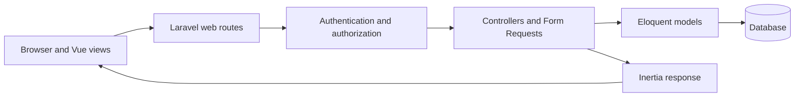

# EduMetric

EduMetric is a web-based Teacher Performance Evaluation System for Carmen Senior High School, Carmen, Cotabato. It supports digital collection and score computation with strand-based student evaluations, faculty feedback, and administrative reports.

This README translates the [capstone outline](<docs/labis outline kani na jud.docx>) into the application's scope. The [implementation plan](docs/IMPLEMENTATION_PLAN.md) describes how to build it using **Laravel MVC** and **Spatie Laravel Permission for RBAC**.

## Current status

The application now implements school account and enrollment management, strands, teacher assignments, configurable evaluation forms, scheduled evaluation periods, student submissions, weighted scoring, released teacher results, printable reports and CSV exports. Laravel controllers, Eloquent models, Inertia/Vue pages, and Spatie Permission enforce the workflow.

The school must supply its approved questions, weights, scales, and performance bands. School pilot evaluation and deployment remain separate operational steps.

## Purpose and scope

The system supports one school's Senior High School department. The outline identifies STEM, ABM, HUMSS, and TVL, approximately 1,500 students, and 66 teachers as its context. Actual enrollment and assignments must come from school records.

The system provides decision support; school administrators retain responsibility for official performance judgments. Payroll, grading, attendance, SMS notifications, social-work case management, and multi-school administration are outside scope.

## Users and capabilities

| Role | Capabilities | Access boundary |
| --- | --- | --- |
| Admin | Manage accounts, strands, faculty assignments, evaluation forms, schedules, results and reports | School-wide administration through explicit permissions |
| Teacher | View personal evaluation summaries, performance trends, and feedback | Own results only, subject to the school's release policy |
| Student | Select an authorized strand, view eligible teachers, and complete evaluation forms | Assigned strand and applicable evaluation period |

The principal is treated as an Admin user for the initial design, because the outline defines three roles. A separate principal role requires a confirmed need.

## Functional requirements

1. **Authentication and account management:** secure login, logout confirmation, role-specific dashboards, and administrator-managed account activation and deactivation.
2. **Strands and teacher assignments:** assign faculty to a strand, grade level, section, and school year. After login, students select a strand permitted by their recorded enrollment; the server checks eligibility on every evaluation request.
3. **Evaluation forms:** configure questions, descriptions, order, weights, rating scales, and comments using the school's existing evaluation instrument. Preserve the version used for submitted evaluations.
4. **Evaluation periods:** define schedules and deadlines, attach an approved form, monitor participation, and control result release.
5. **Student submissions:** validate all required answers, record responses atomically, and prevent duplicate evaluations for the same student, faculty member, and period under the proposed initial rule.
6. **Score computation:** calculate criterion summaries, overall results, and performance levels using a confirmed school rubric. Keep teacher ratings separate from the research questionnaire used to assess system usability.
7. **Results and reports:** provide faculty and period filters, summaries, charts, trends, feedback, printable reports, and authorized downloads.
8. **Usability evaluation:** collect pilot feedback from Admin, Faculty, and Student respondents about functionality, usability, reliability, clarity, and satisfaction; summarize frequencies, means, and percentages for the research output.

## Architecture

The application remains a Laravel MVC monolith. Existing Inertia/Vue pages serve as the **View** layer; there is no requirement for a separate API application.



| MVC responsibility | Location | Rules |
| --- | --- | --- |
| Models | `app/Models` | Relationships, casts, eligibility queries, and domain rules; preserve evaluation history |
| Views | `resources/js/pages` and existing shared components | Render authorized data and forms; use Wayfinder routes; do not compute authoritative scores |
| Controllers | `app/Http/Controllers` | Coordinate authorized requests, model operations, transactions, and Inertia responses |
| Validation | `app/Http/Requests` | Validate allowed fields, ratings, schedules, and contextual eligibility |
| Authorization | `app/Policies`, route middleware, and Spatie permissions | Enforce permissions plus ownership, enrollment, and period restrictions on the server |

Use ordinary Laravel directories and Eloquent. Avoid repository layers, CQRS, microservices, or a separate domain framework. Extract a small calculation helper only when it makes the scoring rule independently testable; this supports MVC without replacing it.

## RBAC with Spatie Permission

Use `spatie/laravel-permission`, the `HasRoles` trait on `User`, and the existing `web` guard. Permissions belong to roles and users inherit them through role assignment, following [Spatie's recommended permission model](https://spatie.be/docs/laravel-permission/v8/best-practices/roles-vs-permissions).

| Permission | Admin | Teacher | Student |
| --- | :---: | :---: | :---: |
| `dashboard.view` | Yes | Yes | Yes |
| `users.manage` | Yes | — | — |
| `roles.assign` | Yes | — | — |
| `strands.manage` | Yes | — | — |
| `assignments.manage` | Yes | — | — |
| `forms.manage` | Yes | — | — |
| `periods.manage` | Yes | — | — |
| `evaluations.monitor` | Yes | — | — |
| `evaluations.submit` | — | — | Yes |
| `results.view-all` | Yes | — | — |
| `results.release` | Yes | — | — |
| `results.view-own` | — | Yes | — |
| `reports.generate` | Yes | — | — |
| `reports.download` | Yes | — | — |

Policies must combine permission checks with record restrictions. A Teacher user with `results.view-own` cannot request another teacher's results. A Student user with `evaluations.submit` cannot evaluate an unassigned teacher. Hiding a button does not enforce authorization.

Do not duplicate Spatie roles in a `users.role` column or build custom role pivot tables. Role assignment must be an authorized administrative operation, never a field accepted from public registration or profile updates.

## Technology baseline

Inspected on November 12, 2026. PHP package versions below come from `composer show --direct`; JavaScript entries are declared ranges in `package.json`.

| Component | Existing baseline |
| --- | --- |
| PHP | Runtime 8.4.26; use PHP 8.4 for this project |
| Laravel | 13.40.0 |
| Inertia Laravel adapter | 3.7.0 |
| Fortify | 1.41.0 |
| Wayfinder | 0.1.23 |
| Vue and TypeScript | Vue `^3.5.13`, TypeScript `^5.2.2` |
| Inertia Vue adapter | `^3.0.0` |
| Styling | Tailwind CSS `^4.1.1` and existing UI components |
| Frontend tooling | Vite Plus 1.4.0 through the existing npm scripts |
| Testing and analysis | Pest 5.3.5, Larastan 3.14.0, Pint 1.32.1 |
| Database | SQLite in `.env.example`; MySQL is specified in the outline and proposed for school deployment |
| RBAC | Spatie Laravel Permission 8.5.0 |

Spatie's current [compatibility table](https://spatie.be/docs/laravel-permission/v8/prerequisites) lists Laravel 13 support in the 7.x–8.x package families. The project locks version 8.5.0 and uses the v8 documentation.

## Run the application

Prerequisites: PHP 8.4 with the required Laravel/database extensions, Composer, and Node.js/npm compatible with the locked frontend dependencies.

For a fresh local checkout, run:

```bash
composer run setup
composer run dev
```

The setup script installs Composer packages, copies `.env.example` only if `.env` is absent, generates an application key, runs migrations, installs npm packages, and builds frontend assets. Configure the intended database before running it. Do not run key generation against an established deployment.

The starter defaults to SQLite. To use MySQL, create a database and configure `DB_CONNECTION`, `DB_HOST`, `DB_PORT`, `DB_DATABASE`, `DB_USERNAME`, and `DB_PASSWORD` in the local `.env` before migrations. Do not commit credentials.

After migrations, run `php artisan db:seed`. Local/testing environments receive verified Admin, Teacher, and Student accounts at `admin@edumetric.test`, `teacher@edumetric.test`, and `student@edumetric.test`, each initially using `password`. Re-seeding preserves existing passwords. Production/staging do not receive demo accounts. The strand seeder adds STEM, ABM, HUMSS, and TVL without duplicating existing records.

To use the full workflow:

1. Sign in as Admin, create school accounts, and record student strand, school year, grade, and section.
2. Assign Teachers to the corresponding strand and academic context.
3. Create the approved evaluation form. Questions are required; scores use the weighted mean. A form is locked once a period references it; use Duplicate for a revised version.
4. Create a period with opening/closing times in Philippine time and a minimum response threshold, then open it.
5. Students select their assigned strand, complete their eligible teacher evaluations, and submit once per teacher/period.
6. Admin reviews reports, closes collection, and releases results. Teachers see only their own released groups meeting the minimum response threshold (default 3).
7. Admin can print reports and download CSV exports. Teacher feedback omits respondent account identifiers; comments remain as students write them.


Useful existing checks:

```bash
php artisan test --compact
npm run check
npm run types:check
npm run build
composer run types:check
```

The implementation was verified with the full Pest suite on an isolated PostgreSQL database, TypeScript checks, PHPStan, frontend lint, and a production asset build. The default test configuration uses in-memory SQLite and requires the PDO SQLite extension.

## School configuration and remaining decisions

| Topic | What the outline leaves open | Proposed treatment |
| --- | --- | --- |
| Login identifier | Describes username/password; starter uses email/password | Confirm school usernames or school IDs and adapt Fortify without losing password recovery |
| Enrollment | Requires strand selection without defining verification | Admin records school-year enrollment; selection is limited to permitted strands |
| Teacher eligibility | Mentions strand, grade, section, and school year | Use strand and school year as the baseline; apply grade/section restrictions when recorded |
| Duplicate rule | Does not define repeat evaluations | One final submission per student, faculty member, and period; confirm whether subject-specific evaluations are needed |
| Scoring | Does not supply the approved teacher instrument or complete calculation rules | Obtain question scales, weights, performance bands, missing-answer rules, and rounding before scoring implementation |
| Privacy and release | Requires confidentiality without defining anonymity or release timing | Hide respondent identities from faculty; release faculty results after administrative review; confirm comment visibility and minimum response counts |
| Downloads | Requires printable/downloadable reports without prescribing formats | Begin with printable HTML and CSV; add PDF/XLSX only if required and approved |
| Usability survey | Does not clearly require an in-app survey module | Conduct a separate pilot questionnaire and analysis first; add survey screens only if requested |

The outline contains inherited social-work captions, conflicting timetable labels, and an inconsistent row in its four-point usability scale. Some report mockups show scores above four. These are reference issues to resolve, not approved teacher-rating rules or extra application modules. Use the teacher-evaluation objectives and relevant functional descriptions as the scope baseline.

## Delivery plan

Implement in this order: confirm school rules → authentication and RBAC → academic records → form versions and periods → student submissions → scoring and faculty results → reports → pilot verification and deployment preparation.

See [the implementation plan](docs/IMPLEMENTATION_PLAN.md) for file responsibilities, task dependencies, acceptance criteria, and test coverage. The core workflow is implemented; school-specific configuration, provider connection, pilot feedback, and deployment validation remain. No delivery date is inferred from the outline's historical Gantt chart.
